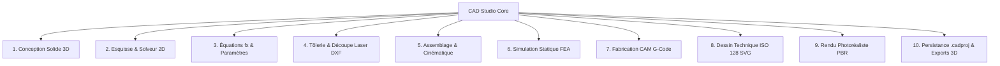

# CAD Studio — Suite Industrielle Complète (Équivalent Autodesk Fusion 360 & FreeCAD)

[](https://python.org)
[](https://doc.qt.io/qtforpython/)
[](https://github.com/elalish/manifold)
[]()
[]()

**CAD Studio** est une suite logicielle paramétrique industrielle 3D complète inspirée d'**Autodesk Fusion 360** et de **FreeCAD**.
Elle intègre la totalité des ateliers d'ingénierie mécanique : modélisation solide, esquisses contraintes 2D, tôlerie industrielle avec facteur K, équations paramétriques $fx$, assemblages cinématiques, simulation FEA von Mises, fabrication CAM G-code CNC, mise en plan 2D ISO 128 et studio de rendu photoréaliste PBR.

---

## 🌟 Les 10 Ateliers Technologiques



### 1. 🛠️ Conception Solide Paramétrique (Design Workspace)
- **Primitives 3D exactes** : Boîte, Cylindre, Sphère, Cône via le noyau C++ Manifold3D.
- **Opérations d'ingénierie avancées** :
  - **Extrusion** : Balayage linéaire de profils d'esquisse fermés.
  - **Révolution 360°** : Révolution autour d'un axe de révolution.
  - **Perçage paramétrique (Hole Tool)** : Alésages cylindriques avec profondeur et diamètre calibrés.
  - **Évidement volumique (Shell)** : Coques à épaisseur de paroi constante pour boîtiers et plasturgie.
  - **Répétitions linéaires & circulaires** : Matrices rectangulaires et polaires.
  - **Miroir (Mirror)** : Symétries planes selon $XY$, $XZ$, $YZ$.
  - **Combiner Booléen (CSG)** : Union (Join), Différence (Cut), Intersection.
- **Historique temporel (Timeline Fusion 360)** :
  - Barre de lecture chronologique ($\text{Début}, \text{Précédent}, \text{Lecture}, \text{Suivant}, \text{Fin}$).
  - Curseur de retour dans le temps (**Rollback Slider**) pour recalculer l'arbre DAG séquentiellement.
- **Inspecteur de paramètres en direct** : Mise à jour instantanée des cotes 3D.

### 2. 📐 Esquisse 2D & Solveur de Contraintes Géométriques
- **Solveur non-linéaire** basé sur l'algorithme des Moindres Carrés TRF (*Trust Region Reflective*) de SciPy.
- **Contraintes physiques résolues** :
  - **Coïncident** : Jonction de deux sommets ($u_a = u_b, v_a = v_b$).
  - **Horizontal & Vertical** : Alignement strict sur les axes cartésiens.
  - **Distance** : Imposition de cotes millimétriques entre points ($\sqrt{\Delta u^2 + \Delta v^2} = L$).
  - **Points Fixes** : Ancrage absolu des coordonnées dans le plan.
- **Mode Stylet Interactif** : Traçage directement dans le Viewport avec accrochage sur grille (Snapping à 5 mm).

### 3. 🧮 Moteur de Paramètres Globaux & Équations ($fx$)
- Inspiré de la boîte de dialogue *Change Parameters* d'Autodesk Fusion 360.
- **Analyseur AST sécurisé** (`ast.parse`) sans aucun appel à `eval()` prévenant toute injection de code.
- Support des opérateurs arithmétiques (`+`, `-`, `*`, `/`, `**`, `%`) et fonctions trigonométriques (`sin`, `cos`, `tan`, `sqrt`, `abs`, `min`, `max`, `pi`).
- **Propagation en cascade** : Recalcul automatique des variables dépendantes sur plusieurs passes.

### 4. 📑 Tôlerie Industrielle (Sheet Metal Design)
- **Modélisation de tôle pliée** : Platine de base et rebords pliés (Flanges à 90°).
- **Théorie du pliage et fibre neutre** :
  - Position de la fibre neutre via le **Facteur K** ($K = 0.44$ standard pour l'acier).
  - Développement de l'arc de pliage (**Bend Allowance**) :
    $$BA = \frac{\pi}{180} \cdot \alpha \cdot (R + K \cdot t)$$
  - Déduction au pli (**Bend Deduction**) :
    $$BD = 2 \cdot (R + t) \cdot \tan\left(\frac{\alpha}{2}\right) - BA$$
- **Flan Déplié à Plat (Flat Pattern)** : Calcul de la longueur développée exacte.
- **Export AutoCAD DXF R12** : Calques normalisés `CUT` (contour de découpe laser CNC) et `BEND` (axes de pliage pour plieuse).

### 5. 🔗 Assemblage Mécanique & Détection d'Interférences
- Liaisons cinématiques normalisées : **Rigide**, **Pivot (Revolute - 1 DDL)**, **Glissière (Slider - 1 DDL)**.
- Animation cinématique pas à pas.
- **Détection des collisions physiques par CSG** : Calcul exact du volume d'intersection ($V_{\text{interf}} > 0$).

### 6. 📊 Simulation Statique par Éléments Finis (FEA)
- Analyse de résistance mécanique sous charge statique :
  - Calcul de la **contrainte équivalente de von Mises** $\sigma_{vm}$.
  - Flèche maximale et déplacement élastique en micromètres ($\mu\text{m}$).
  - **Facteur de sécurité** :
    $$s = \frac{\sigma_y}{\sigma_{\max}}$$
  - Cartographie thermique rainbow directement visualisée dans le Viewport 3D (Bleu = $0\text{ MPa} \rightarrow$ Rouge = $\sigma_{\max}$).

### 7. ✂️ Fabrication Assistée par Ordinateur (CAM / FAO)
- **Génération de trajectoires 2.5D** :
  - **Surfaçage (Facing)** : Balayage en zigzag sur le brut supérieur.
  - **Contournage (Contour)** : Passes d'ébauche et de finition avec descente par paliers en Z.
- **Post-Processeur G-Code ISO/GRBL** :
  - Compatible centres d'usinage, fraiseuses CNC, Shapeoko, GRBL, LinuxCNC, Mach3.
  - Gestion des avances ($F$), vitesses de broche ($S$) et hauteurs de sécurité.

### 8. 📋 Mise en Plan Technique 2D ISO 128
- Génération automatique des **4 vues orthogonales normalisées** :
  - **Vue de Face**, **Vue de Dessus**, **Vue de Droite**, **Vue Isométrique 3D**.
- Lignes d'arêtes visibles et axes de symétrie.
- **Cotations dimensionnelles automatiques** (Largeur, Hauteur, Profondeur).
- **Cartouche d'ingénierie ISO** : Titre, Auteur, Matériau, Échelle, Date, Norme ISO 128.
- **Exporteur vectoriel SVG haute résolution**.

### 9. 📸 Atelier de Rendu Photoréaliste PBR (Render Studio)
- Matériaux physiques réalistes (**Physically Based Rendering**) :
  - Albédo, Rugosité (Roughness), Métallicité (Metallic), Spécularité, IOR.
  - Approximation de **Fresnel-Schlick** :
    $$F = F_0 + (1 - F_0)(1 - \cos\theta)^5$$
  - Bibliothèque de finitions : Aluminium brossé, Chrome miroir, Or 24K, Cuivre, Laiton, Titane, Fibre de carbone, Plastiques ABS.
- **Studio lumineux à 3 points** (Key light, Fill light, Rim light) avec illumination ambiante.
- Moteur de lancer de rayons avec **Z-buffer logiciel** et export d'images **PNG haute définition**.

### 10. 💾 Persistance de Projet (.cadproj) & Exportations 3D
- Sauvegarde et rechargement de projets complets en format JSON `.cadproj` sans perte d'historique.
- Exportations industrielles 3D :
  - **STL Binaire** calibré pour impression 3D (Bambu Studio, PrusaSlicer, Cura).
  - **Wavefront OBJ** avec normales de sommets.
  - **Stanford PLY**.

---

## 💻 Démarrage Rapide

### Prérequis
- Windows 10/11 ou Linux
- Python 3.12+

### Installation
```powershell
# Cloner le dépôt
git clone https://github.com/jbrandonp/radiant-darwin.git
cd radiant-darwin

# Créer l'environnement virtuel
python -m venv .venv
.\.venv\Scripts\activate

# Installer les dépendances
pip install PySide6 PyOpenGL numpy scipy manifold3d trimesh pytest coverage
```

### Lancement de l'Application
```powershell
python src/main.py
```

### Démonstrateur Intégral (10 Ateliers)
```powershell
python demo_full_suite.py
```
*Génère automatiquement les 5 fichiers d'ingénierie dans `demo_output/`.*

### Exécution des Tests & Couverture (100% Succès)
```powershell
coverage run -m pytest tests/ -v -p no:cov
coverage report --include="src/*" --omit="src/viewport/*,src/ui/*"
```

---

## 🏛️ Architecture du Code

```
radiant-darwin/
├── src/
│   ├── core/                  # Moteur CAO (Manifold3D, DAG, Timeline, Formules fx, Exporteurs)
│   │   ├── types.py           # Types géométriques stricts (Vector3D, Point2D, MeshBuffer)
│   │   ├── geometry.py        # Noyau Solide CSG, primitives et maillages
│   │   ├── sketch.py          # Esquisses 2D et polygones projetés
│   │   ├── feature.py         # Features de base (Box, Cylinder, Sphere, Extrude, Boolean)
│   │   ├── operations_advanced.py # Revolve, Hole, Shell, Pattern, Mirror
│   │   ├── parameters.py      # Moteur d'équations fx et table de paramètres (AST)
│   │   ├── document.py        # DAG séquentiel et curseur de rollback temporel
│   │   ├── serializer.py      # Persistance JSON .cadproj
│   │   └── exporter.py        # Export STL, OBJ, PLY
│   ├── solver/                # Solveur de contraintes géométriques 2D (SciPy TRF)
│   │   └── constraints_2d.py  # Coincident, Horiz, Vert, Dist, Fixed
│   ├── sheetmetal/            # Tôlerie industrielle (Sheet Metal)
│   │   ├── sheet_metal.py     # Facteur K, Bend Allowance/Deduction, Flat Pattern
│   │   └── dxf_exporter.py    # Générateur AutoCAD DXF R12 (calques CUT et BEND)
│   ├── materials/             # Base de données de matériaux & masse
│   │   └── material_db.py     # Propriétés mécaniques, densités, calculs CoG
│   ├── fea/                   # Simulation par éléments finis (FEA)
│   │   └── fea_solver.py      # von Mises, déplacements, gradient de couleur
│   ├── cam/                   # Fabrication assistée par ordinateur (CAM)
│   │   └── cam_engine.py      # Trajectoires 2.5D et post-processeur G-Code ISO/GRBL
│   ├── assembly/              # Assemblage mécanique et cinématique
│   │   └── assembly_manager.py # Liaisons, degrés de liberté, interférences CSG
│   ├── drawing/               # Dessin technique 2D normalisé ISO 128
│   │   ├── drawing_generator.py # 4 vues orthogonales, cotations, cartouche
│   │   └── svg_exporter.py    # Export vectoriel SVG
│   ├── render/                # Studio de rendu photoréaliste PBR
│   │   ├── pbr_material.py    # Matériaux optiques réalistes (Fresnel-Schlick)
│   │   └── raytracer.py       # Lancer de rayons, studio 3-points et export PNG
│   ├── viewport/              # Rendu graphique OpenGL interactif
│   │   ├── gl_renderer.py     # Shading Phong + arêtes CAD noires
│   │   ├── camera.py          # Caméra Orbit / Pan / Zoom
│   │   ├── view_cube.py       # Widget interactif ViewCube
│   │   ├── sketch_mode.py     # Contrôleur d'esquisse et snapping
│   │   └── viewport_widget.py # QOpenGLWidget PySide6
│   ├── ui/                    # Interface utilisateur Fusion 360 Dark QSS
│   │   ├── ribbon.py          # Ruban à 10 ateliers
│   │   ├── timeline.py        # Barre chronologique Fusion 360
│   │   ├── browser_tree.py    # Arbre des corps et esquisses
│   │   ├── properties_panel.py # Inspecteur dynamique de cotes
│   │   ├── dialogs.py         # Boîtes de dialogue modales
│   │   ├── theme.py           # Feuille de style Fusion 360 Dark
│   │   └── main_window.py     # Fenêtre maîtresse
│   └── main.py                # Point d'entrée de l'application
├── tests/                     # 55 tests unitaires et d'intégration
├── demo_full_suite.py         # Démonstrateur autonome des 10 ateliers
└── README.md                  # Documentation complète
```
